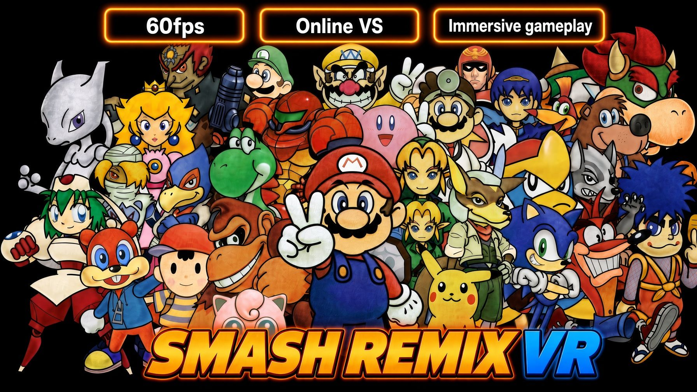

# Smash Remix VR: Meta Quest 3 Standalone

Super Smash Bros. 64 and **Smash Remix 2.0.1** running natively on the Meta Quest 3, in VR, with online play.

> **⚠️ You must own the game.** This project does not include Super Smash Bros. or any of its assets. Use a ROM made from your own cartridge (North American / USA version). For Smash Remix, patch that ROM yourself with the official Smash Remix 2.0.1 patch. Do not ask for ROMs.

## Features

- **60 FPS** battles.
- **Smash Remix 2.0.1:** all the Remix fighters, stages and modes, chosen on the start window.
- **Online VS:** 2 to 4 players, each on their own Quest, with a room code. (Cloudflare or similar)
- **Immersive view:** look around the stage with your head; the camera follows your fighter.
- **Sharp picture** with anti-aliasing.
- **Plug and play:** pick your ROM in the start window and play.

## What's new in 0.8.5

- **Smash Remix online:** turn on "Online game: Smash Remix" in the start window, then Host or Join. Everyone in the room plays Remix.
- **The game pauses** while the Quest menu is open (not in online matches).
- **Quitting from the Quest menu** closes the game at once, and your save is kept.
- **Smoother VS intro screens** in 1P mode, with no crackling sound.
- **Cancel on Host** returns to the start window instead of crashing.

## Install

1. Download the APK from the [Releases](../../releases) page.
2. Install it with SideQuest (or `adb install`).
3. Start it from **Library > Unknown Sources**.
4. In the start window, choose your Super Smash Bros. (USA) ROM and/or your Smash Remix 2.0.1 ROM. The game checks the file and remembers it; after that just press **Play Smash Bros.** or **Play Smash Remix**.

## Controls

| Button | Action |
|---|---|
| Left stick | Move |
| A / B | A / B |
| Right grip | Jump |
| Left trigger | Z (shield) |
| Right trigger | R (grab) |
| Right stick | Smash attacks in battle, C buttons in menus |
| Left menu button | Start / pause |

## Credits

Smash Remix by the Smash Remix team ([smashremix](https://github.com/JSsixtyfour/smashremix)); it is free and must never be sold. Built on [N64Recomp](https://github.com/N64Recomp/N64Recomp), [N64ModernRuntime](https://github.com/N64Recomp/N64ModernRuntime) and [RT64](https://github.com/rt64/rt64), with the [Super Smash Bros. decompilation](https://github.com/VetriTheRetri/ssb-decomp-re).
